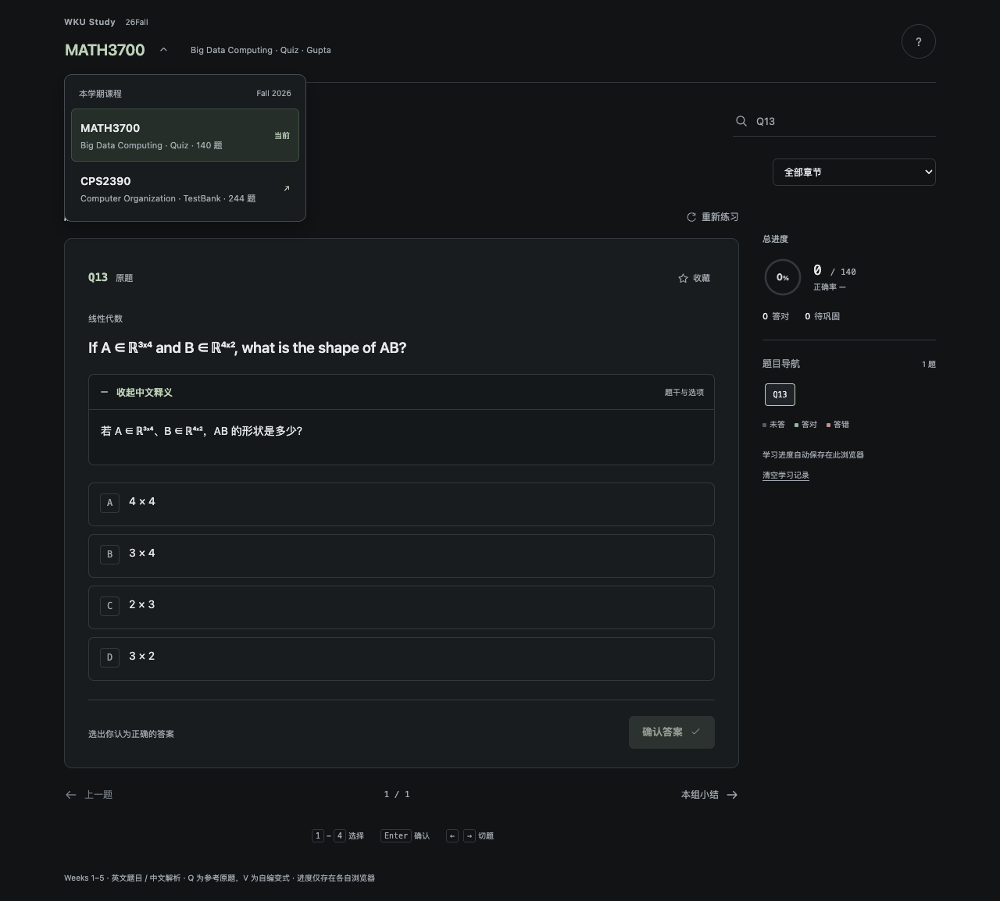

# WKU-MATH3700-26Fall

**Wenzhou-Kean University · MATH3700 · Gupta · Fall 2026 (26Fall)**

[Practice online](https://wangzeyu2006729-beep.github.io/WKU-MATH3700-26Fall/) · [Other course: CPS2390](https://wangzeyu2006729-beep.github.io/WKU-CPS2390-26Fall/)

140 practice questions: 100 instructor-provided Mid Quiz reference questions and 40 independently written, slightly harder variants based on Weeks 1–5. This is one of the repository owner's Fall 2026 courses at WKU. Both course sites use a compact dark interface and independent browser progress.



## Course information

| Field | Details |
|---|---|
| University | Wenzhou-Kean University (WKU) |
| Course | MATH3700 |
| Instructor | Gupta |
| Semester | Fall 2026 (26Fall) |

Use the course selector at the top to switch between MATH3700 and CPS2390. Questions are in English; controls and supplementary study notes are in Chinese. This is an independent revision aid, not an official university site or a statement of instructor endorsement.

## Chinese meaning and course navigation

Click **查看中文释义** below a question to expand its Chinese meaning, including all choices. Click again to collapse it. Formulas and code identifiers remain intact; fill questions retain blanks. This does not reveal an answer or change grading. The per-question expansion state survives refresh, and search accepts Chinese keywords.

The course name opens a compact dark course panel with the current course marked. Use arrow keys or Tab to move, Enter to follow a course, and Escape or an outside click to dismiss. Both course pages retain their independent learning records.

The shared course catalogue and presentation components support adding real courses later. Only the current Quiz and TestBank are included; exercises and assignments are not added. See [adding courses](docs/adding-courses.md).

## Coverage

| Topic | Original | Variants | Total |
|---|---:|---:|---:|
| Big data foundations | 10 | 3 | 13 |
| Linear algebra | 24 | 7 | 31 |
| Matrix calculus and eigenvalues | 10 | 5 | 15 |
| Probability and statistics | 30 | 10 | 40 |
| High-dimensional geometry | 9 | 4 | 13 |
| Distances and metrics | 8 | 5 | 13 |
| Gradient descent and SGD | 9 | 6 | 15 |
| **Total** | **100** | **40** | **140** |

## Practice controls

- Choose all questions, original questions, or variants, then combine with a chapter filter.
- Original labels are `Q01–Q100`; variant labels are `V01–V40`. Search a label or keyword.
- Select an answer and confirm to reveal the solution. Chinese explanations cover the calculation and common pitfalls.
- Variants include related original-question numbers and difficulty. Five challenge questions supply the formulas needed in the stem.
- Keyboard: `1`–`4` or `A`–`D` select; `Enter` confirms; arrow keys navigate; `S` bookmarks.

Incorrect-answer review collects the latest mistakes; a correct retry removes a question when the list is refreshed. Restarting hides solutions while retaining previous records. Clearing course progress requires confirmation.

## Source material and editorial notes

The 100 reference questions were supplied from Gupta's *MATH 3700: Big Data Computing — 100-Question Multiple-Choice Quiz*. The 40 variants are independent practice material, not instructor-issued questions or exam predictions.

- `source.txt`: supplied original text.
- `variants.json`: independently written variants and related-question references.
- `build.py`: parses the originals, repairs extracted notation, adds Chinese explanations, and merges the variants.

Original question text, choice order, answer keys, explanations, and notes are preserved. Notes for Q3, Q58, Q64–65, Q88, and Q90 identify wording or extraction issues. Q64–65 use the standard error supplied in the question; Q90 uses `acfdeg`.

## Progress and privacy

Records stay in the current browser's localStorage under `math3700-practice-v1`. There is no backend, account, tracking, or answer upload. The other course uses its own key; switching courses or clearing one course does not clear the other.

Original internal IDs 1–100 remain stable; variants use 101–140. Existing answers, attempts, bookmarks, drafts, and position remain compatible, including when a saved 100-question queue expands to 140.

The repository rename changes the page path but keeps the same GitHub Pages hostname and storage key, so existing online records remain available in the same browser profile. Different devices, browsers, and profiles have independent records; tabs in one profile share them. There is no cross-device synchronization. Clearing browser data removes progress; private browsing may discard it on close. If storage is unavailable, practice remains usable for that session with a warning.

## Build and offline use

`index.html` embeds the full interface and question bank. Download it and open it to practice offline. Online and offline copies have separate browser storage; switching to the other online course requires an internet connection.

Rebuild with Python 3, without third-party Python dependencies:

```bash
python3 build.py
```

`template.html` contains the interface; `questions.json` and `index.html` are generated outputs.

## Verification

Serve locally and use a disposable test browser profile; the functional checks clear that profile's progress:

```bash
python3 -m http.server 8000 --bind 127.0.0.1
npx --yes --package @playwright/cli playwright-cli -s=math3700 open http://127.0.0.1:8000/index.html
npx --yes --package @playwright/cli playwright-cli -s=math3700 run-code --filename verify-browser.js
npx --yes --package @playwright/cli playwright-cli -s=math3700 run-code --filename verify-ui.js
npx --yes --package @playwright/cli playwright-cli -s=math3700 run-code --filename verify-merge.js
npx --yes --package @playwright/cli playwright-cli -s=math3700 run-code --filename verify-isolation.js
```

Checks cover question navigation and grading, filters, persistence, storage-denied operation, and layouts from 320 to 1440 pixels. Isolation checks use independent browser contexts. See `docs/verification.json` and the additional course checks in `docs/` for verified results.

## License and attribution

Application code is provided under the [MIT License](LICENSE). Original course questions and answer keys retain their respective authors' rights; the code license does not relicense those materials. See [CONTENT_NOTICE.md](CONTENT_NOTICE.md).
